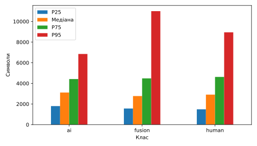
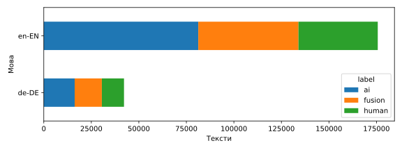
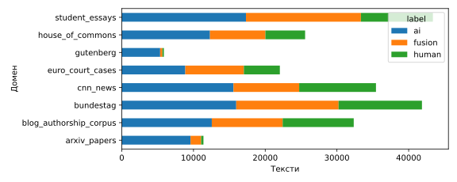
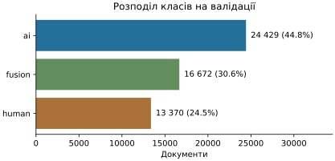
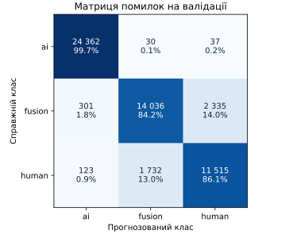

# Homework 3 — класифікація походження тексту

## Дані та валідація

Задача полягала в класифікації англо- й німецькомовних документів за трьома мітками. `human` означає людський текст, `ai` — згенерований, а `fusion` — людський текст, частково переписаний мовною моделлю. У `fusion` відредагований фрагмент може займати лише невелику частину документа. Це мотивувало перевірку кількох ділянок тексту.

Для порівняння моделей використовувався фіксований спліт із 217 881 навчального та 54 471 валідаційного документа. Ознаки TF-IDF підганялися на навчальній частині. Macro-F1 надає кожному класу однакову вагу, тому разом із ним відстежувався F1 для `fusion`. Тестовий CSV містив прогнози для всіх 25 000 ID у порядку зразка подання.

У навчальній частині 80,6% документів англомовні. Баланс класів змінюється за доменами. Наприклад, у `gutenberg` 5 351 із 5 871 тексту мають мітку `ai`. Медіанні довжини близькі, але 95-й перцентиль для `fusion` становить 10 998 символів проти 6 848 для `ai`. Такий довгий хвіст підсилює мотивацію перевірити охоплення кількох частин документа.

## Класична модель та енкодер

Початковий baseline використовував TF-IDF для словесних і символьних n-грам та лінійний SVM. Параметр регуляризації `C` обирається за macro-F1 на валідації. Побудова словника на великій вибірці вичерпала доступну RAM. Для масштабування n-грами відображалися у простір ознак фіксованого розміру за допомогою хешування. Частоти документів для IDF накопичувалися пакетами, а лінійний класифікатор SGD оновлювався на розріджених пакетах.

Багатомовний XLM-R донавчався на 60 000 текстах із навчальної частини. Для довгих документів модель отримувала початок і кінець у межах 384 токенів. Чекпойнт першої епохи дав 0,87900 macro-F1 під час окремого прогону збережених ваг, використаного для фінального ансамблю. Навчальний лог зафіксував 0,87918 після першої епохи.

## Експерименти

**Розмір навчальної вибірки.** Для хешованого TF-IDF + SGD, що читав початок документа, збільшення вибірки зі 120 000 до 217 881 текстів підняло macro-F1 з 0,76071 до 0,76098. F1 для `fusion` знизився з 0,67114 до 0,66902. За цієї конфігурації додаткові документи дали незначний приріст загальної метрики.

**Охоплення довгих документів.** Варіант `distributed` використовував початок, середину й кінець документа. На тій самій повній навчальній частині він досяг 0,85484 macro-F1 і 0,80118 F1 для `fusion`. Разом зі способом вибірки фрагментів змінилися ліміт символів і кількість епох, тому експеримент оцінює конфігурацію в цілому.

**Поєднання моделей.** Ансамбль XLM-R і `hash-full-distributed` підняв macro-F1 з 0,87900 до 0,89542 відносно одиночного XLM-R. F1 для `fusion` зріс з 0,83699 до 0,85822. Ваги суміші та поправка класу підбиралися на тій самій валідації, тому ця оцінка включає ефект відбору.

## Фінальні варіанти

Оцінки XLM-R з `checkpoint-1875` і CPU-моделі `hash-full-distributed` усереднювалися з вагами 0,5 / 0,5. Перед вибором класу оцінка `fusion` множилася на `exp(-0.1)`. Вихідний файл цього ансамблю — `select-full-cpu-xlmr/submission_1.csv`. Публічний результат цього файлу на Kaggle становив **0,90867 macro-F1**. Варіант із середнім вікном дав найкращу локальну оцінку **0,89983 macro-F1**. Його публічна оцінка невідома. Команди навчання та генерації CSV наведено в репозиторії. [Код](https://github.com/yelgor/AI_lab_3/tree/a1a4d4abd3b42cdb950138da9c99612dcfe86656) · [Навчання](RUNBOOK.md#final-model-training) · [Генерація прогнозів](RESULTS.md#відтворення-прогнозів-і-відбору)

## Додаток

### EDA навчальної частини

| Клас | Кількість |
| --- | --- |
| ai | 97511 |
| fusion | 67010 |
| human | 53360 |

#### Довжина текстів у символах

| Клас | P25 | Медіана | P75 | P95 |
| --- | --- | --- | --- | --- |
| ai | 1800 | 3111 | 4420 | 6848 |
| fusion | 1563 | 2772 | 4484 | 10998 |
| human | 1487 | 2908 | 4624 | 8948 |



#### Мова

| Мова | ai | fusion | human |
| --- | --- | --- | --- |
| de-DE | 16241 | 14297 | 11653 |
| en-EN | 81270 | 52713 | 41707 |



#### Домен

| Домен | ai | fusion | human |
| --- | --- | --- | --- |
| arxiv_papers | 9593 | 1475 | 321 |
| blog_authorship_corpus | 12554 | 9879 | 9909 |
| bundestag | 15962 | 14266 | 11626 |
| cnn_news | 15576 | 9159 | 10708 |
| euro_court_cases | 8859 | 8164 | 5018 |
| gutenberg | 5351 | 314 | 206 |
| house_of_commons | 12299 | 7727 | 5538 |
| student_essays | 17317 | 16026 | 10034 |



#### Приклади з навчальної частини

Мітки взято з набору даних. Для fusion розмітка задається на рівні документа.

| Клас | Уривок |
| --- | --- |
| ai | The House will know that these are challenging times for many across our nation, with economic headwinds pushing unemployment figures upwards. However, I want to reassure this House that the Conservative Government stands resolute in its c… |
| fusion | Herr Präsident! Liebe Kolleginnen und Kollegen! Lieber Hubertus Heil! Meine sehr geehrten Damen und Herren! Wir Sozial- und Arbeitsmarktpolitikerinnen und ‑politiker und das Bundesministerium tragen Verantwortung für die Frage, ob sich die… |
| human | I remember one summer vacation, that my family and I took, where we went to another state to visit another relative that we haven't seen in awhile. Summer vacation had been the same for many years, summer vacation is when teenagers take a … |

### Порівняння моделей

| Модель | Навчальні тексти | Validation macro-F1 | F1 fusion |
|---|---:|---:|---:|
| Хешований TF-IDF + SGD, head | 120 000 | 0,76071 | 0,67114 |
| Хешований TF-IDF + SGD, head | 217 881 | 0,76098 | 0,66902 |
| Хешований TF-IDF + SGD, distributed | 217 881 | 0,85484 | 0,80118 |
| XLM-R, перша епоха | 60 000 | 0,87900 | 0,83699 |
| Ансамбль XLM-R + CPU | — | 0,89542 | 0,85822 |
| Ансамбль із середнім вікном | — | **0,89983** | **0,86455** |

### Додатковий експеримент із серединою довгих документів

Відбір дав вагу 0,75 прогнозу XLM-R, у якому 30% оцінки походить із середнього вікна, і вагу 0,25 моделі `hash-full-distributed`. Оцінку `fusion` перед вибором класу множили на `exp(-0.25)`. Macro-F1 на 54 471 валідаційному тексті становив **0,89983**, на 0,44 п.п. вище за ансамбль без середнього вікна. Одночасно змінилися ваги моделей і поправка для `fusion`, тому приріст стосується всієї конфігурації. Публічний результат 0,90867 у звіті належить попередньому ансамблю.

### Розподіл класів і метрики на валідації



| Клас | Precision | Recall | F1 | Документи |
|---|---:|---:|---:|---:|
| `ai` | 0,98289 | 0,99726 | 0,99002 | 24 429 |
| `fusion` | 0,88847 | 0,84189 | 0,86455 | 16 672 |
| `human` | 0,82919 | 0,86126 | 0,84492 | 13 370 |

#### Матриця помилок

Рядки відповідають справжнім класам, стовпці — прогнозам. Відсотки на графіку обчислено від кількості документів у рядку.



| Факт / прогноз | `ai` | `fusion` | `human` |
|---|---:|---:|---:|
| `ai` | 24362 | 30 | 37 |
| `fusion` | 301 | 14036 | 2335 |
| `human` | 123 | 1732 | 11515 |

Найчастіше модель плутала `fusion` і `human`. Для 2 335 документів `fusion` вона передбачила `human`, а для 1 732 документів `human` — `fusion`.

### Відтворення EDA та метрик

Для відтворення таблиць і графіків потрібні офіційний `train.csv`, оригінальний спліт і метрики відповідного запуску. Генератор створює `appendix/APPENDIX.md` та SVG-файли.

```bash
python -m pip install matplotlib
python build_appendix.py --data data --split .local-training/runs/split.json \
  --metrics .local-training/runs/select-full-cpu-xlmr/metrics.json --out appendix
```
